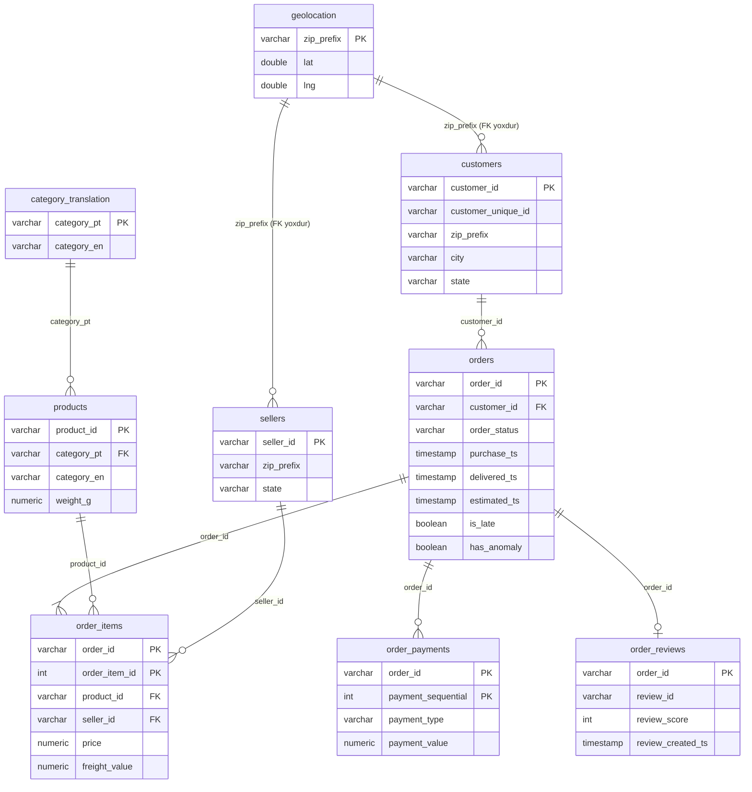

# ER diaqram: Olist (clean sxemi)

GitHub bu diaqramı avtomatik çəkir (Mermaid). Şəkil faylı lazım olsa, `olist.dbml` faylını dbdiagram.io-da açıb PNG kimi export edin.

## Əlaqələrin izahı

| Əlaqə | Növ | İzah |
|---|---|---|
| customers → orders | 1 : çox | bir `customer_id` bir sifarişə bağlıdır. Eyni real müştərinin (`customer_unique_id`) bir neçə `customer_id`-si ola bilər |
| orders → order_items | 1 : çox | bir sifarişdə bir neçə məhsul sətri ola bilər |
| orders → order_payments | 1 : çox | bir sifariş bir neçə ödənişlə (məsələn kart + voucher) ödənə bilər |
| orders → order_reviews | 1 : 0..1 | təmizləmədən sonra sifariş başına 1 rəy saxlanıb |
| products → order_items | 1 : çox | |
| sellers → order_items | 1 : çox | |
| category_translation → products | 1 : çox | portuqalca kateqoriya adı açardır |
| geolocation → customers / sellers | 1 : çox | `zip_prefix` ilə bağlıdır, FK qoyulmayıb |
